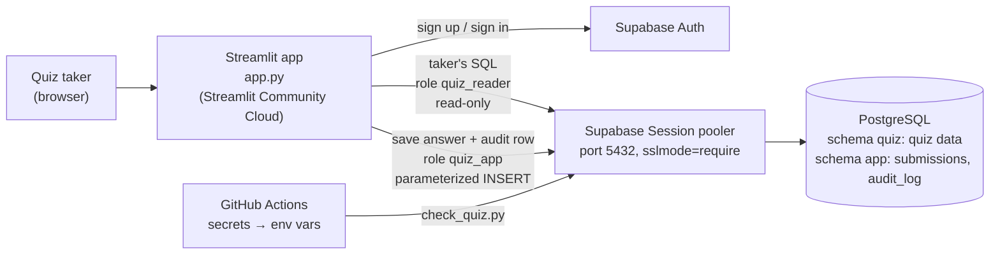

# SQL Quiz: Graduate Course Enrollment

[](https://github.com/<your-github-user>/<your-repo>/actions/workflows/quiz-db-check.yml)

**Live quiz:** https://<your-app-name>.streamlit.app

A small SQL quiz that runs against a live, hosted PostgreSQL database. A quiz taker signs in, opens a question, writes a SQL query, runs it, and sees the result table straight from the database. The quiz has 5 questions worth 20 points in total. Each question includes a hint with the expected SQL and the expected result.

---

## How to take the quiz (for graders)

1. Open the live quiz URL above.
2. In the left sidebar, choose **Create account**, enter any email and a password (6+ characters), and click **Create account**. You are signed in immediately (email confirmation is turned off).
   Returning users use the **Sign in** tab.
3. Pick a question (Q1–Q5). Expand **Database schema** to see the tables.
4. Type a query in **Your SQL** and click **▶ Run**. The rows come from the live database.
5. The app tells you whether your result matches the expected result. Results are compared by value, not by SQL text.
6. Click **💾 Save** to store your answer. Saved questions show **✔ saved**.
7. Open **💡 Hint** under a question to see the expected SQL and the expected result.

Signed-out visitors can read the questions, but **Run** and **Save** are disabled, and the server refuses both actions without a signed-in user.

## The quiz

Topic: a fictional graduate program's students, courses and enrollments.

| # | Question | Skills | Points |
|---|---|---|---|
| Q1 | MIDS students sorted by start year and name | SELECT, WHERE, ORDER BY | 4 |
| Q2 | Number of courses per department | GROUP BY, COUNT | 4 |
| Q3 | Students enrolled in IDS 706 in Fall 2026 | 3-table JOIN | 4 |
| Q4 | Students with ≥ 3 completed courses and average ≥ 3.5 | JOIN, GROUP BY, HAVING, ROUND | 4 |
| Q5 | Top student(s) per course, ties included | CTE, `RANK() OVER (PARTITION BY …)` | 4 |
| | | **Total** | **20** |

Questions, hints and expected results live in [`questions.json`](questions.json).

### Database schema

| Table | Columns |
|---|---|
| `students` | `student_id` (PK), `name`, `program`, `start_year` |
| `courses` | `course_id` (PK), `course_code`, `title`, `department`, `credits` |
| `enrollments` | `enrollment_id` (PK), `student_id` → students, `course_id` → courses, `term`, `grade_points` (NULL = in progress) |

12 students, 10 courses and 38 enrollments across Fall 2025, Spring 2026 and Fall 2026. The full script is [`sql/init.sql`](sql/init.sql).

---

## Architecture



| Part | What it is |
|---|---|
| Hosted database | Supabase PostgreSQL. Quiz data in schema `quiz`; saved answers and the audit log in schema `app`. |
| Authentication | Supabase Auth, email + password. The sign-in state lives in the server-side Streamlit session, and `run_query` / `save_answer` check it again before touching the database. |
| Running SQL | `quizlib.run_readonly()` connects as **`quiz_reader`**, starts a `READ ONLY` transaction, sets a 5 s timeout, runs one `SELECT`/`WITH` statement, returns at most 500 rows and rolls back. |
| Saving answers | `quizlib.save_submission()` connects as **`quiz_app`** and inserts with `%s` parameters. |
| GitHub Actions | `.github/workflows/quiz-db-check.yml` runs unit tests, then `scripts/check_quiz.py` against the live database using GitHub Secrets. |

### Security design

- **No passwords in git.** `.env` is in `.gitignore`; `init.sql` creates roles without passwords; CI reads GitHub Secrets; the deployed app reads Streamlit secrets.
- **Least-privilege roles.**

  | Role | Can do | Cannot do |
  |---|---|---|
  | `quiz_reader` | `SELECT` on `quiz.*` | write anything; see schema `app`; run longer than 5 s |
  | `quiz_app` | `INSERT`, `SELECT` on `app.submissions`, `app.audit_log` | `UPDATE`/`DELETE`/`TRUNCATE`; read the quiz tables |

- **Defense in depth for taker SQL:** one statement only, must start with `SELECT` or `WITH`, read-only transaction, read-only role, and no privileges to write even if read-only mode is switched off.
- Tables live in custom schemas (`quiz`, `app`), not `public`, so they are not exposed through Supabase's auto-generated REST API.

### Extra credit

| Item | Where |
|---|---|
| Parameterized queries (no f-string SQL) | every `INSERT`/`SELECT` in `quizlib.py` uses `%s` placeholders |
| Audit log of who ran or saved what | `app.audit_log`: user, action (`run`/`save`), question, SQL, success, row count, error, timestamp |
| Integrity check: takers cannot edit the log | `quiz_app` has no `UPDATE`/`DELETE` privileges, **and** triggers on `app.audit_log` reject every `UPDATE`, `DELETE` and `TRUNCATE`, even from the `postgres` owner. CI verifies this on every run. |

Try it in the Supabase SQL Editor:

```sql
DELETE FROM app.audit_log;
-- ERROR: audit_log is append-only: DELETE is not allowed
```

---

## Repository layout

```
.
├── app.py                         # Streamlit UI: sign-in, questions, Run, Save
├── quizlib.py                     # settings, SQL checks, DB access, result comparison
├── questions.json                 # 5 questions, hints, expected results
├── sql/init.sql                   # schema, seed data, roles, audit-log triggers
├── scripts/check_quiz.py          # live-database check used by GitHub Actions
├── tests/test_quizlib.py          # unit tests (no database needed)
├── .github/workflows/quiz-db-check.yml
├── requirements.txt
├── .env.example                   # template; copy to .env (never committed)
└── .gitignore
```

---

## Set it up yourself

### 1. Supabase project and data

1. Create a free project at <https://supabase.com/dashboard>. Save the database password.
2. Open **SQL Editor → New query**, paste [`sql/init.sql`](sql/init.sql), and click **Run**.
3. In a new SQL Editor query (not saved to git), give the two roles passwords:

   ```sql
   ALTER ROLE quiz_reader WITH PASSWORD '<strong password 1>';
   ALTER ROLE quiz_app    WITH PASSWORD '<strong password 2>';
   ```

   Tip: `openssl rand -hex 20` makes a strong password with no special characters.

4. **Authentication → Sign In / Providers → Email:** keep Email enabled and turn **Confirm email** off, so graders can sign in right after creating an account.

### 2. Run locally

```bash
python3 -m venv .venv
source .venv/bin/activate
pip install -r requirements.txt
cp .env.example .env        # then fill in your values
python scripts/check_quiz.py
streamlit run app.py
```

Where to find each value:

| Setting | Where in Supabase |
|---|---|
| `SUPABASE_URL` | Project Settings → Data API → Project URL |
| `SUPABASE_KEY` | Project Settings → API Keys → anon / publishable key (never the service_role / secret key) |
| `DB_HOST` | **Connect** → **Session pooler** → host (e.g. `aws-0-us-east-1.pooler.supabase.com`) |
| `DB_READER_USER` | `quiz_reader.<project-ref>` |
| `DB_APP_USER` | `quiz_app.<project-ref>` |
| `DB_*_PASSWORD` | the passwords from step 1.3 |

`<project-ref>` is the 20-character id in your project URL. The Session pooler needs `role.project-ref` as the user name.

### 3. GitHub Secrets and Actions

Repository **Settings → Secrets and variables → Actions → New repository secret**:

`DB_HOST`, `DB_READER_USER`, `DB_READER_PASSWORD`, `DB_APP_USER`, `DB_APP_PASSWORD`

The workflow runs on every push to `main`, on pull requests, on demand (**Actions → Quiz DB check → Run workflow**) and twice a week. The scheduled runs also stop the free Supabase project from pausing after a week of inactivity.

What it checks:

1. Unit tests for the SQL guard and result comparison.
2. Points add up to 20 and every question has a hint.
3. Every hint query returns exactly the expected rows from the live database.
4. `quiz_reader` cannot delete data.
5. The audit log rejects updates.

### 4. Deploy

1. Push the repo to GitHub.
2. At <https://share.streamlit.io>, click **Create app**, pick this repo, branch `main`, file `app.py`.
3. Under **Advanced settings → Secrets**, paste the same values as your `.env` in TOML form:

   ```toml
   SUPABASE_URL = "https://<ref>.supabase.co"
   SUPABASE_KEY = "<anon key>"
   DB_HOST = "aws-0-<region>.pooler.supabase.com"
   DB_PORT = "5432"
   DB_NAME = "postgres"
   DB_SSLMODE = "require"
   DB_READER_USER = "quiz_reader.<ref>"
   DB_READER_PASSWORD = "<password>"
   DB_APP_USER = "quiz_app.<ref>"
   DB_APP_PASSWORD = "<password>"
   ```

4. Deploy, then put the app URL at the top of this README.

### Changing the quiz

Edit `sql/init.sql` (data) or `questions.json` (questions and hint SQL), re-run `init.sql` in Supabase, then refresh the expected results from the database:

```bash
python scripts/check_quiz.py --write
```

---

## Troubleshooting

| Symptom | Fix |
|---|---|
| `password authentication failed` / `Tenant or user not found` | The user must be `quiz_reader.<project-ref>`, and the host must be the **Session pooler** host of your project's region. |
| `connection timed out` | You used the Direct connection host (`db.<ref>.supabase.co`). Use the Session pooler. |
| `SSL connection is required` | Set `DB_SSLMODE=require`. |
| `relation "students" does not exist` | Run `sql/init.sql` in the SQL Editor. |
| Sign-up says "check your email" | Turn off **Confirm email** (setup step 1.4). |
| Site cannot connect after a week | The free project paused. Restore it in the dashboard; the scheduled workflow prevents this. |
